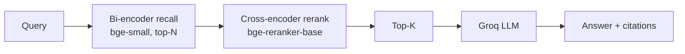

# 03 — Reranker RAG (Bi-encoder recall → Cross-encoder rerank)

**Project 03 of 50 — AI Engineering Portfolio**

Two-stage retrieval on **Cloudflare Workers**: fast **bi-encoder recall**, then an accurate **cross-encoder reranker**, then a grounded **Groq** answer.

## 🌐 Live Demo
- **App:** https://reranker-rag.deepvision-aiportfolio.workers.dev
- **GitHub:** https://github.com/deepvisionkararhaider-crypto/reranker-rag

## 🎯 Problem
A bi-encoder embeds query and document separately, so they never interact — fast but coarse. A cross-encoder runs the query and document through one transformer jointly, judging relevance far more accurately, but it is too slow for full-corpus search.

## 🏗️ Architecture

**Genuine cross-encoder:** Cloudflare Workers AI `@cf/baai/bge-reranker-base` scores each `{query, passage}` pair jointly and returns a scalar relevance score; results are reordered by that score.

## ✨ Features
- Bi-encoder recall over D1, then true cross-encoder rerank
- API exposes `rank_before` vs `rank_after` so the reordering is visible
- Configurable candidate count (5–40)
- Groq grounded answers with citations (shows bi + rerank score)
- Error handling + smoke tests

## 🛠️ Stack
Cloudflare Workers · Hono · Workers AI (bge-small **and** bge-reranker-base cross-encoder) · D1 · Groq

## 📁 Structure
`src/worker.js` · `src/core.js` (chunking, embeddings, cosine, **rerank**, Groq, D1)

## 🔑 Env
```bash
GROQ_API_KEY=          # secret
LLM_MODEL=openai/gpt-oss-120b
```

## 🚀 Run
```bash
npm install
echo "GROQ_API_KEY=your_key" > .dev.vars
npm run dev && BASE=http://localhost:8787 bash tests/smoke.sh
```

## 📡 API
`GET /api/health` · `GET /api/stats` · `POST /api/documents` · `POST /api/search` `{query, candidates}` · `POST /api/query`

## 🧪 Testing
**Verified:** `6 passed, 0 failed` (health, reranker binding, ingest, cross-encoder scores + rank shifts, malformed input, query).

## 📊 Performance
Per-request `recall_time_ms`, `rerank_time_ms`, `generation_time_ms` are returned live. Not benchmarked at scale yet.

## 📄 License
MIT.
